# wasmcart-defold-examples

Example [Defold](https://defold.com) games built as
[wasmcart](https://github.com/wasmcart/wasmcart) carts: a `.wasc` holds a
WebAssembly program plus its assets and runs unmodified on any host that
implements the ABI.

The engine these build against is
[wasmcart-defold](https://github.com/wasmcart/wasmcart-defold), which vendors
Defold and adds a cart runtime. Build it first; the instructions below assume
it sits beside this repo. The release this repo is built against is named in
[`engine.lock`](engine.lock).

Two kinds of cart come out of here: the twelve small examples and 2D games
under the repo root, and the 3D **[showcase games](#showcase-games)** under
`games/`, open-source Defold projects by other developers fetched at a pinned
commit and built as carts. Every cart is built twice from one content
archive: a GL cart (`<name>.wasc`) and, where the game's shaders compile to
WGSL, a WebGPU cart (`<name>_webgpu.wasc`) for hosts with wasmcart's WebGPU
tier.

## Status

| | |
| --- | --- |
| Engine boots as a cart | works |
| Lua `init` / `update` / `on_input` | works |
| Sprites, fonts, tilemaps, GUI, labels | works |
| Input: keyboard, mouse | works |
| Input: gamepad (12 buttons + sticks + triggers) | works |
| Sound | works (440 Hz measured against a 440 Hz source) |
| Frame delta (`dt`), timers, `go.animate` | works |
| Physics: gravity, contacts, `collision_response` | works |
| Save data (`sys.save` / `sys.load` / `sys.exists`) | works, persists across sessions |
| `resource.create_texture` / `set_texture` | works |
| Particle FX, collection proxies, buffers | works |

`apitest` reports **14 PASS 0 FAIL** and `buffertest` **7 PASS 0 FAIL** on this
engine. Four defects were open when these examples were first written and all
four are now closed; each is worth recording because none of them announced
itself as what it was.

**Geometry did not draw.** Two GL imports were missing:
`glGetActiveUniformBlockiv` and `glGetActiveUniformsiv`. The auto-stub returned
0, so the engine read a 2-byte size for a 64-byte `mat4` uniform block, built a
zero view-projection matrix, and put every vertex off-screen. No GL error was
raised at any point. The fix is in `wasmcart/src/webgl_imports.js`.

**`dt` was near zero.** The engine takes its frame delta from
`dmTime::GetMonotonicTime()`, which on a host-stepped cart measures real time
that barely passes: 120 host frames accumulated 0.026s instead of 2s. Timers
never fired, physics never moved and `go.animate` never completed, and all
three looked like three separate bugs. `DM_PLATFORM_WASMCART` now advances a
virtual clock by one 60 Hz frame per `wc_render()`, so `dt` is exactly 0.01667.

**Gamepads never arrived.** There was no gamepad driver for this platform, and
`hid_native.cpp` only calls a driver's `DetectDevices` once at install time
plus on a GLFW device-changed callback that a cart never receives. Even with a
driver, the one detect ran before the host had written a pad block, so no pad
was ever created. There is now `hid_gamepad_driver_wasmcart.cpp`, and a cart
build polls for devices each `Update()`.

**`sys.save` could not write.** A cart has no filesystem, so every `fopen`
failed. `sys.save`/`sys.load`/`sys.exists` now route into the ABI's save block
(`platform_wasmcart_save.cpp`), which the host persists across sessions.

One thing was never broken: `resource.set_texture` works, and the test that
reported it as unsupported was wrong. It used the pre-1.13 constant spelling
(`resource.TEXTURE_TYPE_2D` rather than `graphics.TEXTURE_TYPE_2D`) and a
`pcall` swallowed the message that said so.

## Play the examples

Every example is a self-contained `.wasc`. With Node installed, no checkout is
needed to play one:

```bash
npx wasmcart planetoid/planetoid.wasc
npx wasmcart breakout/breakout.wasc
```

The same file runs on
[wasmcart-native](https://github.com/wasmcart/wasmcart-native) on the desktop,
as a [RetroArch core](https://github.com/wasmcart/wasmcart-libretro), on
[Android](https://github.com/wasmcart/wasmcart-android), and in a browser. No
per-target build, no page to embed it in.

Build the carts first with `./build-cart.sh <name>`, or download them from the
GitHub Actions artifacts (see
[Continuous integration](#continuous-integration)).

## Showcase games

Seven open-source Defold projects by other developers, built as carts at a
pinned upstream commit. Each stays theirs: the credit, the licence and the
link below are the point of this section, and the whole of what this repo
changes is in `games/<id>/patches/` (and `overrides/`, for a shader inside a
dependency). `games/<id>/game.json` records the repository, commit, author,
licence and the changes' reasons; `tools/fetch-games.mjs` checks a game out
at that commit and applies the patches, and `tools/build-cart.mjs` builds it,
relinking the engine through the wasmcart-defold SDK when a game has native
extensions.

Every screenshot below was taken from the cart as it runs on the wasmcart Node
host, on WebGPU where the game has a WebGPU cart (`tools/screenshot.mjs`).

### Treasure Scene

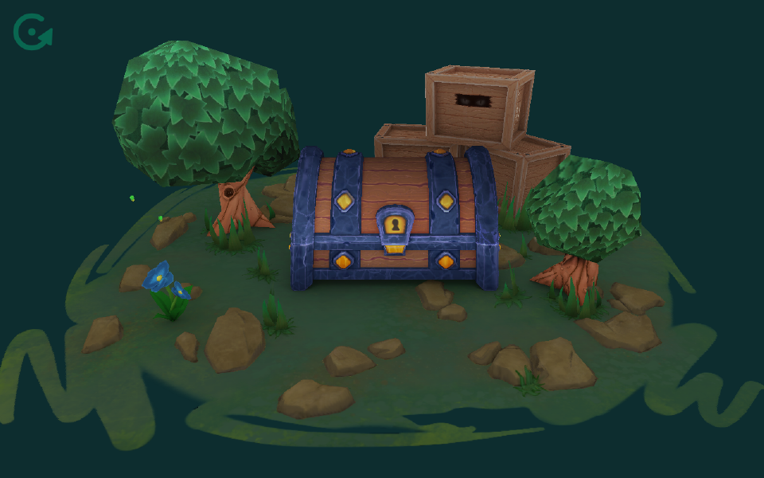

A stylized 3D scene showing Defold's rendering features: a treasure chest on
a turntable among crates and trees, with lighting, shadows and a PBR-style
material setup. A/D or left/right turn the table; the left mouse button opens
the chest.

**By [FlexYourBrain](https://github.com/FlexYourBrain)** (Agustin), from
[FlexYourBrain/Basic3d_TreasureScene](https://github.com/FlexYourBrain/Basic3d_TreasureScene),
MIT. Art by Agustin R. Also on [itch.io](https://flexyourbrain.itch.io/treasure-scene).
GL and WebGPU carts; no changes to the project.

### Little Coaster

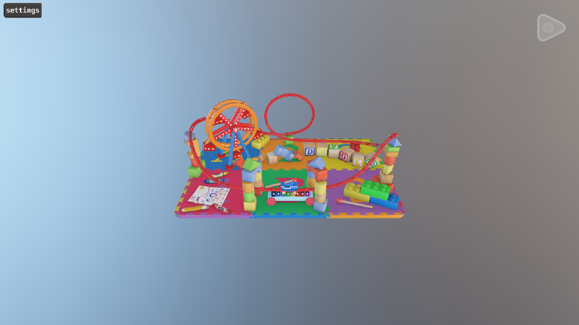

A miniature roller coaster on a playroom floor: a looping track, a ferris
wheel, toy blocks and crayons, rendered with Defold PBR. FlexYourBrain's entry
to the Defold [Tiny Worlds community challenge](https://forum.defold.com/t/community-challenge-tiny-worlds/81931);
every asset was made from scratch for it. The play button starts the ride.

**By [FlexYourBrain](https://github.com/FlexYourBrain)** (Agustin), from
[FlexYourBrain/sample_littlecoaster](https://github.com/FlexYourBrain/sample_littlecoaster),
MIT. Uses [vantage](https://github.com/Jhonnyg/vantage) by Jhonny Göransson,
[dirtylarry](https://github.com/andsve/dirtylarry) by Sven Andersson and
[defold-pbr](https://github.com/defold/defold-pbr) by the Defold Foundation.
GL and WebGPU carts; no changes to the project. This game is what found the
WebGPU cube-map binding bug fixed in wasmcart-defold (its environment map
drew nothing in compatibility mode).

### Horror 3D

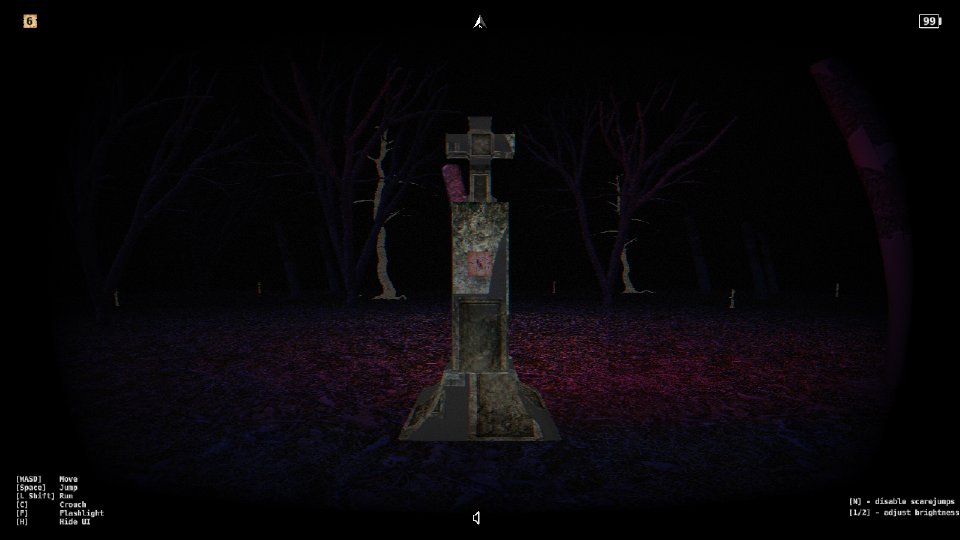

A first-person horror game in the style of Slender: collect the pages
scattered through a dark forest before the thing hunting you catches up.
Pawel Jarosz's entry to Made With Defold Jam 2023. WASD moves, Shift runs,
Space jumps, C crouches, F is the flashlight, the mouse looks; N disables the
scare jumps and 1/2 adjust brightness.

**By [Pawel Jarosz](https://github.com/paweljarosz)**, from
[paweljarosz/horror_3d_game_mwdj_2023](https://github.com/paweljarosz/horror_3d_game_mwdj_2023),
MIT. Built on [Illumination](https://github.com/astrochili/defold-illumination)
by Roman Silin (MIT) and [Horri-fold](https://github.com/TheKing0x9/horri-fold)
post-processing by Aayush Kashyap; textures by
[Joao Paulo (3dtextures.me)](https://3dtextures.me); models from cgtrader's
free models (low-poly zombie, dead trees, realistic trees, metal door, cross
stone, candles, meatcube arm), each linked in the project's README; uses
[defold-operator](https://github.com/astrochili/defold-operator) and
[defold-trenchbroom](https://github.com/astrochili/defold-trenchbroom) by Roman
Silin, [pigeon](https://github.com/paweljarosz/pigeon) by Pawel Jarosz and
[defold-pointer-lock](https://github.com/indiesoftby/defold-pointer-lock) by
Indiesoft LLC. GL and WebGPU carts. Changes: Defold 1.14 no longer reads
Collada, so its ten `.dae` models are converted to glTF
(`tools/dae2gltf.mjs`); the Illumination shader's texture reads are hoisted
out of branches so it compiles to WGSL; the skybox shader's `transpose` helper
is renamed; the browser pointer-lock extension is replaced by
`cart-ext/pointer_lock`.

### Illumination

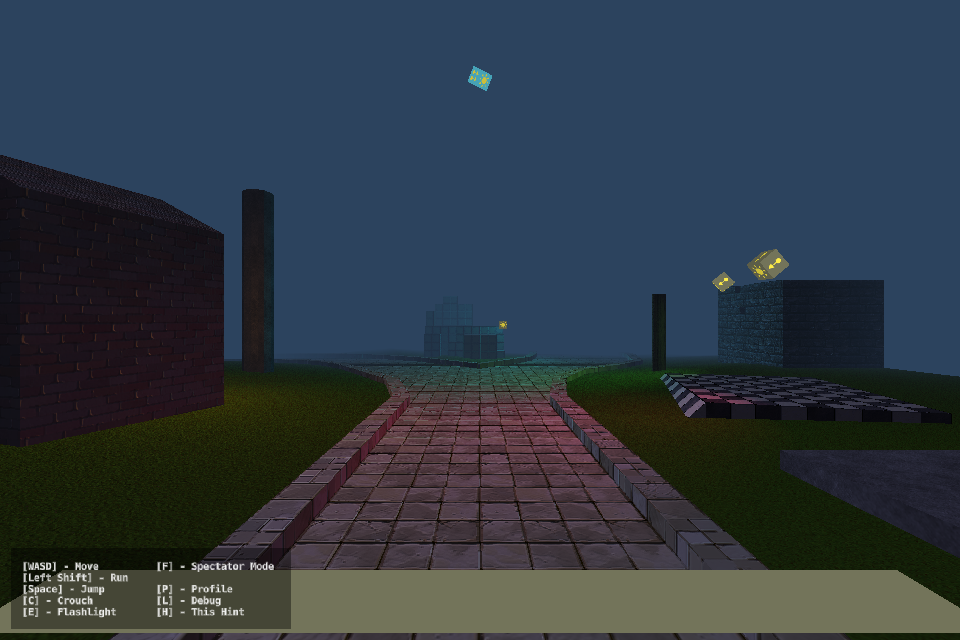

The demo scene of Illumination, a forward-shading lighting library for
Defold: point and spot lights, a flashlight, fog, normal and specular maps,
walked in first person. WASD moves, E is the flashlight, F is spectator mode.

**By [Roman Silin (astrochili)](https://github.com/astrochili)**, from
[astrochili/defold-illumination](https://github.com/astrochili/defold-illumination),
MIT. Textures from [Tiny Texture Pack 1 and 2](https://screamingbrainstudios.itch.io/tiny-texture-pack)
by Screaming Brain Studios; normal and specular maps made with
[Normal Map Online](https://cpetry.github.io/NormalMap-Online/) by @cpetry.
GL and WebGPU carts. Changes: the model shader's texture reads are hoisted out
of branches for WGSL. This scene found the second wasmcart-defold WebGPU fix:
its material declares a light-map texcoord most meshes do not supply, which
GL tolerates and WebGPU refused, so nothing drew.

### Merge Getaway

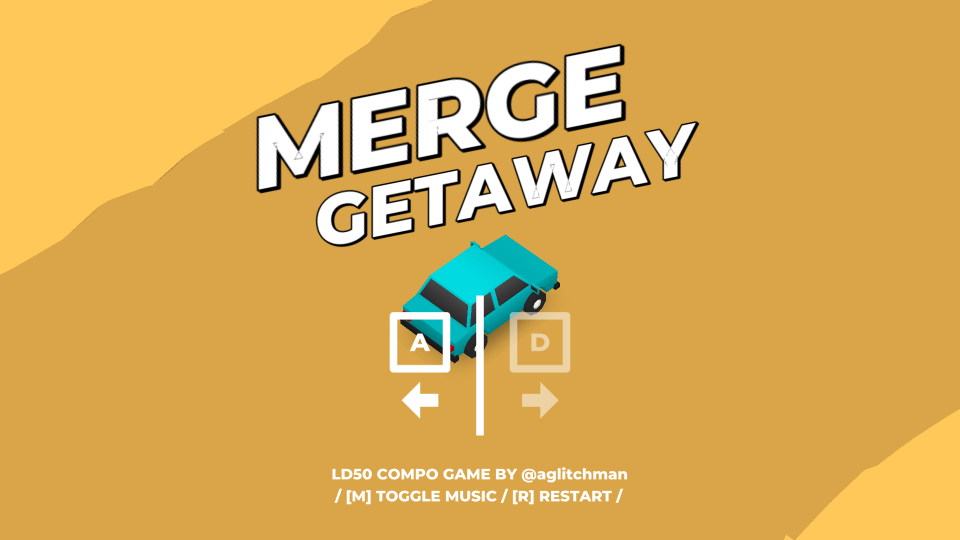

A 3D car-merging getaway: the police are after you, so merge cars of the same
colour to accelerate and escape. Artsiom Trubchyk's Ludum Dare 50 compo
entry. A/D steer, M toggles the music, R restarts.

**By [Artsiom Trubchyk (aglitchman)](https://github.com/aglitchman)**, from
[aglitchman/defold-ld50-game](https://github.com/aglitchman/defold-ld50-game),
MIT. Built on [Scene3D](https://github.com/indiesoftby/defold-scene3d) by
Indiesoft LLC (MIT); models in SideFX Houdini, 2D art in Affinity Designer and
music in Bandlab, all by the author; uses
[ludobits](https://github.com/britzl/ludobits) by Björn Ritzl. Also on
[itch.io](https://glitchman.itch.io/merge-getaway). GL and WebGPU carts.
Changes: Scene3D is moved to its latest commit for Defold 1.14, and three of
its shaders that pass a `sampler2D` as a function parameter are replaced
(`overrides/`); the desktop and browser extensions it depends on (defos,
screenshot, clipboard, its own HTML5 glue) are left out and the two fullscreen
calls guarded; the physics object limit is raised.

### BRDF Deferred Rendering

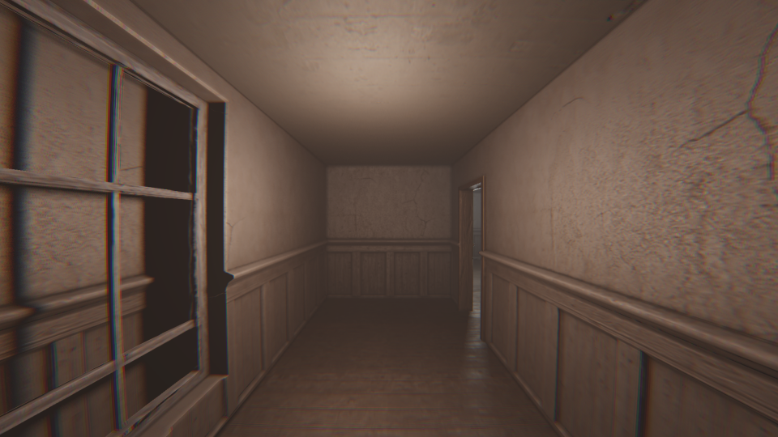

A deferred PBR rendering pipeline for Defold with tiled light culling,
shadows, tone mapping and post-processing, shown in a walkable interior. WASD
moves, the mouse looks.

**By [Mikhail Martianov (martianovdev)](https://github.com/martianovdev)**
([martianov.tech](https://martianov.tech)), from
[martianovdev/Defold-BRDF-Deferred-Rendering-V2](https://github.com/martianovdev/Defold-BRDF-Deferred-Rendering-V2),
CC BY 4.0: this cart is a redistribution of that project at the pinned commit
with the changes in its `patches/`, and the credit here is the attribution
the licence asks for. GL cart only: its shaders pass samplers as function
parameters and do not compile to WGSL. Changes: the Defold 1.13 API migration
(the legacy LiveUpdate loader, the physics listener, `profiler` guarded) and
the builtin Collada quad replaced by the glTF one.

### Stylized Water

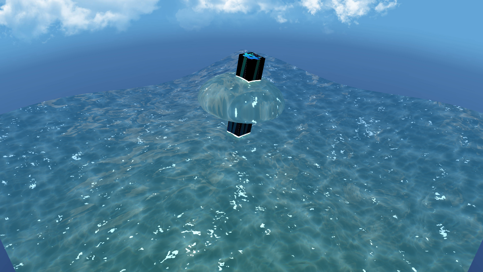

A stylized water shader: animated waves, foam, sparkles and refraction around
floating objects under a cloudy sky. The camera is fixed.

**By [Selim Anaç (selimanac)](https://github.com/selimanac)**, from
[selimanac/defold-stylized-water-shader](https://github.com/selimanac/defold-stylized-water-shader),
MIT, a port of [unity-stylized-water](https://github.com/danielshervheim/unity-stylized-water)
by Daniel Shervheim. GL cart only: the shader samples inside non-uniform
control flow, which WGSL forbids. Changes: none to the project; the
extension-imgui dependency, which the sample never calls, is left out of the
cart engine. This cart found a heap overrun in webgl-node (the Node host's GL
layer) that killed the host on any cart with a large uniform block.

### Not built yet

**[SuperWEIRD Game Kit](https://github.com/ludenio/SuperWEIRDGameKit)** by
[Luden.io](https://luden.io) (CC0) and the
**[Slasher prototype](https://github.com/Dragosha/slasher-prototype)** by
[Igor Suntsev (Dragosha)](https://github.com/Dragosha) (code MIT, art CC0)
are both pinned under `games/` but disabled. Each needs
[extension-spine](https://github.com/defold/extension-spine), which compiles
the Spine Runtimes into the engine, and the
[Spine Runtimes License](https://esotericsoftware.com/spine-runtimes-license)
needs a decision before that ships in a cart engine.

## The games

Five complete games by **[Ben James](https://github.com/benjames-171)**, ported
from his MIT-licensed
[defold-games](https://github.com/benjames-171/defold-games) collection. Each
links to its own source directory in that repository, and ships his licence
alongside it: the games, their code and their art are his work, not ours.

Each is a single `.wasc` file. The same cart runs in a browser, on the desktop
player, as a RetroArch core and on Android, with no per-target build and no
page to embed it in. The ABI is what makes that work: a cart gets a
framebuffer, input, audio and a save block, and nothing else, so it is safe to
run a cart from someone you do not know.

### Mystery Mansion

Explore a haunted house room by room, managing an inventory and a fear meter
that rises as you go.
[source](https://github.com/benjames-171/defold-games/tree/master/Mystery%20Mansion)

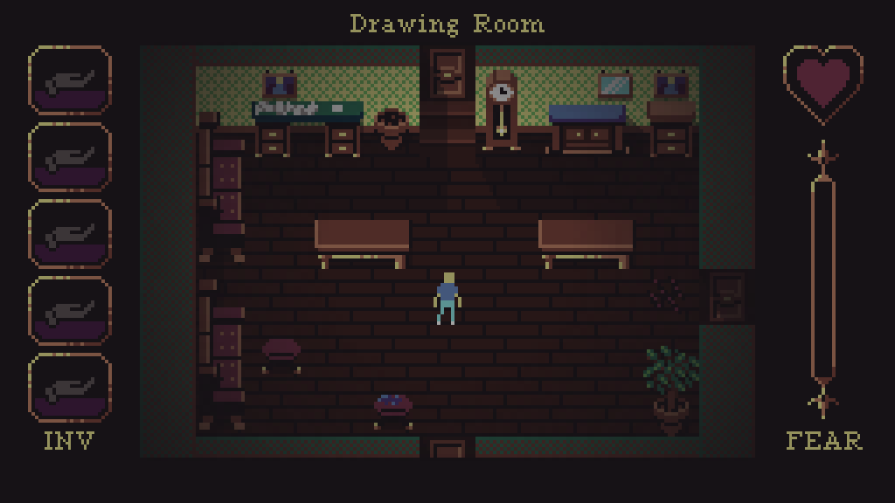

### Exolon: REDUX

A side-scrolling shooter across numbered zones, with bombs and a score chase.
[source](https://github.com/benjames-171/defold-games/tree/master/Exolon)

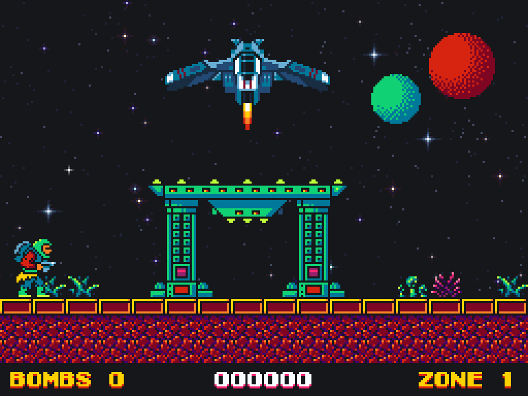

### Planetoid

Fly over scrolling terrain, shooting enemies, with a radar strip along the top.
[source](https://github.com/benjames-171/defold-games/tree/master/Planetoid)

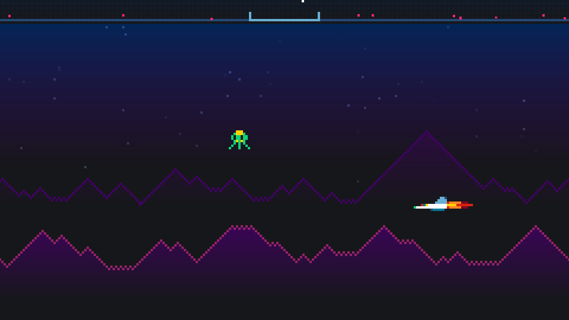

### Pathfinder

A puzzle platformer across nine circuit-board levels. [source](https://github.com/benjames-171/defold-games/tree/master/Pathfinder)

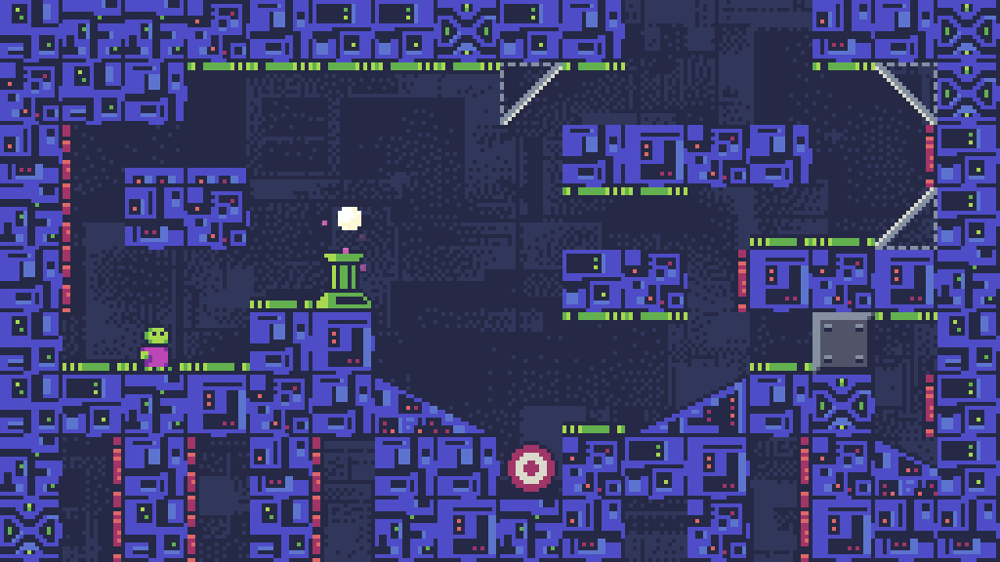

### Unit 4

Miniaturised and injected into a patient, fighting antibodies on the way out.
[source](https://github.com/benjames-171/defold-games/tree/master/Unit%204)

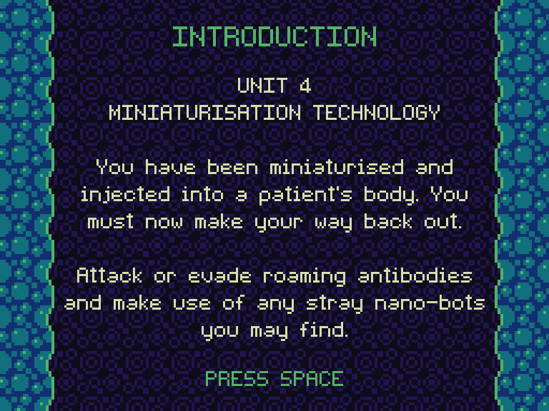

### breakout

Written for this repo rather than ported: paddle, ball, 50 bricks, lives and
scoring, driven by keyboard or gamepad.

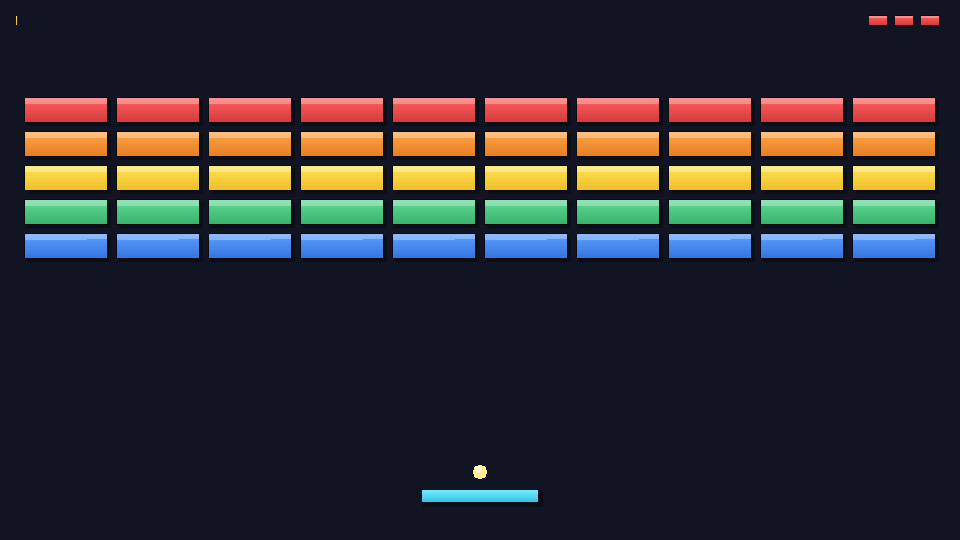

The remaining examples are test fixtures rather than games. They report pass or
fail on screen and are listed below.

## Examples

### `hello_defold`

The Phase 1 gate fixture. Clears to a known colour so a screenshot can be
checked by pixel value, prints three frames, and plays a 440 Hz tone so audio
can be measured rather than assumed. It is deliberately not a game.

### `breakout`

Paddle, ball, 50 bricks, lives and scoring, driving keyboard and gamepad
through the *same* held-state booleans so neither is a second-class alias of
the other, plus three sound effects and a saved high score.

It also carries the one Lua trap worth copying out of here: compare
`action_id` against **pre-hashed constants**, never against
`tostring(action_id)`. A release build has no reverse hash table, so
`tostring()` on an action hash returns `hash: [<unknown:123...>]` and a string
comparison matches nothing. `on_input` runs every frame, the input is
genuinely arriving, and the game ignores every button. That looked exactly
like a dead gamepad driver for as long as it took to print the paddle
position.

### `bombfrog` (on disk, not in this repo)

A full third-party Defold game: title screen, menus, tilemap levels, animated
sprites, enemies and bombs. It is the strongest render test here because it
exercises the pipeline on real content rather than on a fixture, and it is how
the renderer fix was confirmed. It is deliberately NOT committed: it arrived
with no licence file or provenance, so it stays a local test fixture until
those are established.

### `apitest`

Drives, and reports PASS/FAIL on, the surface the games never touch: physics
bodies and contacts, GUI scenes, labels, timers (repeating, one-shot and
cancelled), `go.animate` with easing and a completion callback, `json`, `zlib`,
`hash`, `vmath` beyond add/scale, and `sys.save`/`sys.load`/`sys.exists`
including a value carried from a previous session.

### `inputtest`

Every input path a cart can receive, reported live and printed. Each gamepad
button is checked by *identity*, not merely by count: a driver with two buttons
transposed delivers exactly the same number of actions, so the test compares
each delivered `action_id` against the hash of the action it expects.

### `particles`, `proxytest`, `buffertest`

Particle FX with state callbacks; a collection proxy loaded and confirmed
initialised; and buffer streams, `buffer.copy_stream`, float32 access and a
runtime-generated texture uploaded to the GPU.

## Building an example

Nothing about this was previously written down, and two steps are easy to miss.

```bash
# 1. Build the engine once (see the wasmcart-defold README)
cd ../wasmcart-defold
source ./dmenv.sh
./scripts/build.py --platform=wasm-web --skip-tests build_engine -- \
    --skip-build-tests --with-wasmcart
# -> tmp/dynamo_home/bin/wasm-web/dmengine_wasmcart.wasm

# 2. Build content and pack a cart (content build + pack in one step)
cd ../wasmcart-defold-examples
./build-cart.sh breakout          # -> breakout/breakout.wasc, breakout_webgpu.wasc

# 3. A showcase game: fetch it at its pinned commit, then build it
node tools/fetch-games.mjs horror3d
node tools/build-cart.mjs games/horror3d
```

`build-cart.sh` wraps `tools/build-cart.mjs`, which reads the resolution and
title out of `game.project`, builds the content once with WGSL beside the
GLSL, and packs a GL cart and (when the engine tree has
`dmengine_wasmcart_webgpu.wasm`) a WebGPU cart. It is the supported path;
what follows is what it does, for when something needs changing.

Two things it does beyond that, both for the showcase games:

- **Native extensions.** bob sends any extension with C++ sources to Defold's
  build server, which cannot build a cart engine. The builder gives bob a copy
  of the project with those sources left out, and compiles them into the
  engine itself with the wasmcart-defold SDK (`WASMCART_DEFOLD_SDK`, default
  `../wasmcart-defold/tmp/wasmcart-defold-sdk`, made by `sdk/make-sdk.mjs`
  there). A game's `game.json` can leave an extension out
  (`skipExtensions`, for browser- or desktop-only ones) or replace it with a
  cart implementation (`cartExtensions`, see `cart-ext/pointer_lock`).
- **The Defold 1.13 API migration.** Defold 1.13 removed its deprecated Lua
  APIs and constants, and 1.14 dropped Collada models and some builtins. The
  builder rewrites the mechanical cases (`tools/migrate-defold.mjs`: renamed
  constants, same-argument renames, moved builtins) on its staged copy of the
  project and of every dependency, and names anything it cannot rewrite, so
  a game written for 1.12 or older mostly builds as is. The rest goes in the
  game's `patches/`.

```bash
# bob.jar is Defold's content compiler, downloaded from Defold's archive on
# first use and cached under ~/.cache/wasmcart-defold.
java -jar ~/.cache/wasmcart-defold/bob-<sha1>.jar \
    --root . --platform wasm-web --archive --use-uncompressed-lua-source build
# -> build/default/game.{arci,arcd,dmanifest,projectc}

node ../wasmcart/bin/wasmcart-pack.js \
    --wasm <staged>/cart.wasm --assets <staged>/assets \
    --name Breakout --width 960 --height 540 --output breakout.wasc
```

Three flags are load-bearing and each one fails in a way that does not name
itself:

- **`--archive`** - without it bob compiles the content but writes no
  `game.arci/.arcd/.dmanifest`, and the cart reports
  `Unable to load bootstrap data`.
- **`--platform wasm-web`** - without it bob compiles Lua bytecode for the
  host architecture and the cart fails with
  `bad header in precompiled chunk`.
- **`--use-uncompressed-lua-source`** - bob's archive writer errored here
  when compiling Lua to bytecode for this target. Uncompressed source builds
  cleanly and the engine loads it.

And in the pack step, **`--width`/`--height` are not optional**: the window
sizes itself from the manifest, so a cart that omits them opens at the 1280x720
default while the engine renders at its own resolution.

## Testing a cart

Playing one is covered above. For development, a cart can also be stepped a
fixed number of frames and captured, which is what CI does:

```bash
npx wasmcart breakout.wasc --frames 300
npx wasmcart breakout.wasc --frames 60 --shot out.png
```

It also runs under romdev, which is the better harness when you want frame
stepping, screenshots and memory reads:

```js
loadMedia({ platform: 'wasmcart', path: 'breakout.wasc' })
frame({ op: 'step', frames: 60 })
frame({ op: 'screenshot', path: 'out.png' })
```

romdev loads `.wasc` carts directly: `wasmcart` is one of its platforms.

Two limits worth knowing before writing a test around either harness:

- **A headless machine needs Mesa's software GL.** The carts render through
  real GL, so with no GPU and no display EGL fails to initialise and the
  runtime exits before loading the cart. Install `libegl1` and
  `libgl1-mesa-dri`, then run with `LIBGL_ALWAYS_SOFTWARE=1` and
  `EGL_PLATFORM=surfaceless`. This is what CI does.
- **Headless `--frames` does not persist the save block.** It calls
  `host.destroy()` without the save step the interactive player runs, so a
  cart's `sys.save` survives within the run and is gone on the next one. To
  test persistence, drive `CartHost` directly: run, `getSaveData()`, then load
  a fresh host with `{ saveData }`.
- **romdev drives the pad, not the keyboard, on a wasmcart cart.**
  `pressKey`/`typeText` route to a C64-specific path and error out, so an
  example that must be driven from romdev has to bind gamepad actions.
- **romdev's button names are libretro's, and they are CROSSED relative to
  wasmcart's.** `romdev "a"` sends wasmcart **B**, and `romdev "b"` sends
  wasmcart **A** (`RETROPAD_TO_WASMCART` in `WasmcartHost.js`). A Defold
  action bound to `GAMEPAD_RPAD_DOWN` is wasmcart A, so it is reached with
  `input({op:'press', button:'b'})`. Pressing the name that looks right is
  the single easiest way to conclude a working game ignores input.
- **Hold with `op:'set'` needs the ports form.** A bare
  `input({op:'set', left:true})` is refused because `left` belongs to
  `op:'pointer'`; the pad form is
  `input({op:'set', ports:[{left:true}]})`.

## Testing: run BOTH hosts

```bash
./test-both-hosts.sh              # every example, both hosts
./test-both-hosts.sh bombfrog     # just one
```

A cart has two players here and they fail differently, so checking one proves
less than it looks. This suite has been bitten in both directions:

- `wc_get_info()` resetting the cart's resolution was **invisible under
  romdev**, which does not re-read it after init. The same cart opened cropped
  in the native player, 1280x720 squeezed into a 960x540 window.
- The two GL uniform-block imports were **missing from the native player
  alone**. A cart that needs them draws nothing at all, with every draw call
  succeeding and no GL error raised.

Neither would have been caught by whichever host happened to be handy. The
script reports each side's resolution, the native player's count of stubbed GL
imports (should be 0) and its script-error count, so a disagreement between the
two is visible on one line.

## Gamepad

The pad maps onto Defold's standard action names through the automatic gamepad
config, so `/builtins/input/all.input_binding` works with no device row in
`gamecontrollerdb.txt`:

| wasmcart button | Defold action |
| --- | --- |
| A | `gamepad_rpad_down` |
| B | `gamepad_rpad_right` |
| X | `gamepad_rpad_left` |
| Y | `gamepad_rpad_up` |
| L / R | `gamepad_lshoulder` / `gamepad_rshoulder` |
| START / SELECT | `gamepad_start` / `gamepad_back` |
| d-pad | `gamepad_lpad_*` (delivered as a hat) |
| L3 / R3 | `gamepad_lstick_click` / `gamepad_rstick_click` |

Sticks arrive as `gamepad_lstick_*` / `gamepad_rstick_*` past the dead zone and
triggers as `gamepad_ltrigger` / `gamepad_rtrigger`. All four pad slots are
polled, and a pad that appears mid-session is picked up on the next frame.

## Continuous integration

`.github/workflows/build-carts.yml` packs every example and every enabled
showcase game into GL and WebGPU `.wasc` carts on each push, and runs each GL
cart headless (480 frames for an example, 120 for a game; the WebGPU carts
are packed but not run, as a runner has no WebGPU device). A cart passes only
if the runtime reports completing all its frames; it fails on a short run, a
script error, a cart trap or a failed in-cart assertion. Checking only for
error messages is not enough: a runner with no working GL never loads the
cart at all, so it produces none of those errors and every cart would look
fine.

The finished carts are uploaded as a `carts` artifact with a `SHA256SUMS`
file. **A pushed `v*` tag also gets a GitHub release with every cart attached**,
so a version can be pinned and downloaded without an account.

The engine is not rebuilt here. [`engine.lock`](engine.lock) names a
wasmcart-defold release, and the workflow downloads that release's two
engines and its SDK (checksummed against the release's `SHA256SUMS`), then
installs the emsdk the SDK names for the games' native extensions. Moving to
a new engine is a one-line change to that file. Defold's `bob.jar` is pinned
to the engine's Defold release and cached: it is upstream's tool, so it is
not vendored, rebuilt or redistributed here.

## Licence and credits

The example code in this repository is MIT licensed; see `LICENSE`.

Bundled third-party content is listed with its author and licence in
[CREDITS.md](CREDITS.md). In short: the only third-party asset is DejaVu Sans
Mono Bold, bundled unmodified under the Bitstream Vera licence, with the full
licence text beside every copy of the font. The 8x8 white sprite and the
440 Hz tone were generated for this repository.

The engine itself is separate: Defold is under the
[Defold License 1.0](https://defold.com/license/), which permits modification
but whose clause 4(a) forbids *selling* the work as a Game Engine Product, and
the definition covers the runtime. A free wasmcart-defold is fine; a paid one,
or a paid hosted service producing cart runtimes, is not.
